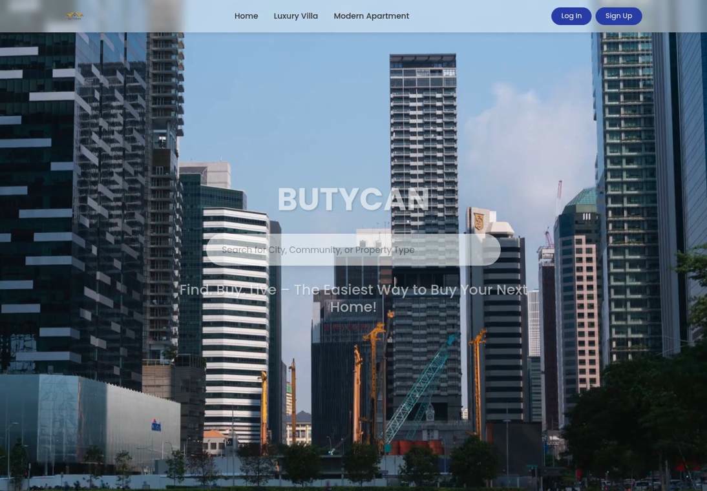

# Real Estate Website

   [](LICENSE) [](https://real-estate-website-nu-seven.vercel.app/)


A multi-page real estate listing website built with plain HTML, CSS and JavaScript.

Live demo: https://real-estate-website-nu-seven.vercel.app

## Preview



## Pages

- `index.html` - home page with featured properties
- `luxury-villa.html`, `modern-apartment.html` - property detail pages
- `login.html`, `signup.html` - auth pages (front end only)

## Tech stack

- HTML5, CSS3, vanilla JavaScript
- Bootstrap (bundled in `lib/`)

## Run locally

No build step. Open `index.html` in a browser, or serve the folder:

```bash
npx serve .
```
